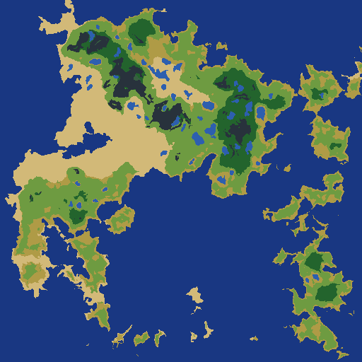

# Terraforge

Deterministic procedural 2D world map generation for games and tools.

Pipeline: **elevation → sea and coast → climate → hydrology → biomes**. Terrain is sampled in world meters, regional climate is modeled in °C and mm/year from latitude, elevation, and prevailing wind, and rainfall drains into rivers, lakes, and basins.

<p align="center">
  
  
  <br />
  
  
</p>

Requires stable Rust. The GUI binary needs `--features gui`.

## Install (Rust dependency)

```toml
terraforge = { git = "https://github.com/jmrfox/terraforge", tag = "v1.0.0" }
```

Pin a tag (or `rev = "<sha>"` during active development) so downstream builds stay reproducible.

## Using as a library dependency

Generation-only use does **not** require `--features gui`.

**Entry points**

- `generate_world(&WorldGenConfig)` — synchronous generation; panics on an empty grid
- `try_generate_world(&WorldGenConfig)` — validates first and returns `ConfigError` on bad input
- `generate_world_with_progress(config, progress)` — optional per-stage progress for large maps
- `WorldGenConfig::from_json(text)` — strict preset loading that rejects unknown fields and invalid values
- `WorldGenConfig::default()` — a regional world at 400 m per cell
- `config.rescaled_to_cell_size(Meters(m))` — change the cell size and scale length-related parameters so the terrain stays the same (climate then responds to the new real size)
- `add_hydrology(&mut map, &config)` — recompute rivers, lakes, and basins on an existing map, without changing its terrain or climate
- `WorldControl` — high-level controls for world size, ruggedness, climate, aridity, and wind
- `sample_default_config(sample_seed, map_seed)` — optional parameter exploration from built-in priors

**`WorldMap` output**

| Field | Range / type | Notes |
|-------|----------------|-------|
| `elevation`, `temperature`, `rainfall` | `[0, 1]` | Normalized simulation units |
| `temperature_c`, `rainfall_mm` | `f32` | Mean annual °C and annual mm |
| `water_mask` | `bool` | Ocean and lakes. Rivers stay land so they can be crossed |
| `dist_to_water` | `u32` | Manhattan distance in cells to the nearest ocean or lake |
| `river_mask` | `bool` | Land cells carrying a river |
| `dist_to_river` | `u32` | Manhattan distance in cells to the nearest river |
| `discharge_m3s` | `f32` | Mean annual flow in m³/s |
| `flow_direction` | `u8` | Downstream direction; use `map.downstream(idx)` to follow it |
| `basin_id` | `u32` | Drainage basin, or 0 on the ocean |
| `water_surface_m` | `f32` | Sea level, lake level, or dry terrain height |
| `ridge_influence` | `[0, 1]` | Mountain-belt signal from elevation stage |
| `biome` | `Biome` | Final classification per cell |
| `generator_version` | `u32` | Algorithm that produced the map |
| `cell_size_m`, `ocean_floor_m`, `max_elevation_m`, `sea_level_m` | `f64` | Physical scale |

Use `map.elevation_m(idx)`, `map.width_m()`, and `map.height_m()` for values in meters. Normalized temperature spans −15 to 35 °C. Normalized rainfall is `1 - exp(-mm / 1500)`, which stays close to `mm / 2000` below 1000 mm and does not saturate in wet climates.

Use `biome_to_id` and `LEGEND_ENTRIES` when you need stable numeric biome IDs. Within 1.x, IDs are fixed:

| ID | Biome |
|----|-------|
| 0 | Ocean |
| 1 | Lake |
| 2 | Ice |
| 3 | Tundra |
| 4 | Taiga |
| 5 | Grassland |
| 6 | TemperateForest |
| 7 | Desert |
| 8 | Savanna |
| 9 | TropicalForest |
| 10 | Mountain |

**Stability**

- The public API surface is `generate_world`, `WorldGenConfig`, `WorldMap`, map storage, export helpers in `preview`, and optional sampling in `priors`.
- The same config and seed produce the same map within a generator version. Generator changes may alter maps, so store maps you need to keep as `.tfmap` files.
- `GENERATOR_VERSION` is recorded on each `WorldMap`. Golden-map tests in `tests/golden_maps.rs` detect unintended output changes.

**High-level controls**

`WorldControl` shapes a world without touching individual parameters. Controls write ordinary `WorldGenConfig` fields, so presets and stored maps need nothing extra.

```rust
use terraforge::{generate_world, WorldControl, WorldGenConfig};

let mut config = WorldGenConfig::default();
WorldControl::Scale.apply(&mut config, 1000.0); // longest side in km
WorldControl::Ruggedness.apply(&mut config, 0.7); // 0 smooth, 1 rugged
WorldControl::Climate.apply(&mut config, 0.75); // 0 polar, 1 tropical
WorldControl::Aridity.apply(&mut config, 0.8); // 0 wet, 1 arid
WorldControl::Wind.apply(&mut config, 90.0); // compass direction the wind blows from
let map = generate_world(&config);
```

| Control | Fields it writes |
|---------|------------------|
| `Scale` | Cell size and all length-related fields, keeping the terrain |
| `Ruggedness` | Ridge weight, detail weight, persistence, minimum ridge influence for mountains |
| `Climate` | Latitude (keeping the hemisphere), temperature offset |
| `Aridity` | Base rainfall, subtropical drying |
| `Wind` | Wind direction |

Position 0.5 on `Ruggedness`, `Climate`, and `Aridity` is the default config. `control.value(&config)` reads a control's position, and `control.is_custom(&config)` reports when its fields were edited to a combination the control cannot produce. Moving the control replaces those fields and leaves all others alone.

**Storing generated maps**

Maps can be saved to a compressed `.tfmap` file and loaded without regenerating them, so a stored world does not change when the generator does.

```rust
use terraforge::{generate_world, load_map_file, save_map_file, MapFileError, WorldGenConfig};

fn store_and_reload() -> Result<(), MapFileError> {
    let config = WorldGenConfig::default();
    let map = generate_world(&config);
    save_map_file("worlds/home.tfmap", &map, &config)?;

    let stored = load_map_file("worlds/home.tfmap")?;
    let (map, config) = (stored.map, stored.config);
    Ok(())
}
```

- `save_map_file` and `load_map_file` work with paths. Saves replace the target file only after a complete write.
- `write_stored_map` and `read_stored_map` work with any `Write` or `Read`. Each map is self-delimiting, so it can sit inside a larger save stream.
- Storage is lossless, and every layer loads back bit-for-bit. Layers that can be rebuilt exactly are omitted to save space.
- Truncated or corrupt data returns `MapFileError` and never yields a partial map.
- A file from an unsupported format version returns `MapFileError::UnsupportedVersion`. There is no migration between format versions, so regenerate older maps.

```rust
use terraforge::{WorldGenConfig, generate_world, sample_default_config};

let map = generate_world(&WorldGenConfig::default());
let celsius = map.temperature_c[0];
let rainfall_mm = map.rainfall_mm[0];

// Randomize numerical parameters from built-in priors (same as GUI "Sample & generate").
let sampled = sample_default_config(99, Some(42));
let random_world = generate_world(&sampled);
```

## Interactive GUI (`mapgui`)

Tweak generation parameters, preview biome/elevation/temperature/rainfall/water layers, and export PNG or JSON presets:

```bash
cargo run --features gui --bin mapgui
cargo run --release --features gui --bin mapgui   # faster generation
```

The app auto-generates on startup (default 512×512). The **World** section holds the five high-level controls, and the map updates when you release one. All individual parameters are under **Advanced**, and a control shows **custom** when its Advanced values no longer match it. Use **Generate** after changing other parameters, or **Sample & generate** to draw numerical parameters from built-in priors and randomize the map seed. Load/save presets as JSON, export the biome PNG, or use **Save map** and **Load map** for full compressed `.tfmap` maps.

To change physical scale while keeping the terrain, enter a value under **Rescale to cell size** in the Grid section and click **Apply**. Editing **Cell size** directly changes only that value, which changes the map.

## Headless map preview (`mapgen` CLI)

```bash
cargo run --bin mapgen -- -o out/map.png --width 512 --seed 42 --stats
cargo run --bin mapgen -- -o out/arid.png --latitude-deg 24 --wind-from-deg 90 --seed 42
cargo run --bin mapgen -- -o out/world.tfmap --seed 42
cargo run --bin mapgen -- --load-map out/world.tfmap -o out/world.png
cargo run --bin mapgen -- -o out/map.png --sample --stats
cargo run --bin mapgen -- -o out/map.png --sample --sample-seed 99 --seed 42 --stats
cargo run --bin mapgen -- -o out/map.tiff --format tiff --width 512 --seed 42 --stats
cargo run --bin mapgen -- --batch mapgen_presets/example_batch.json --out-dir out/ --stats
cargo run --bin mapgen -- --batch mapgen_presets/sample_batch.json --out-dir out/ --stats
cargo run --bin mapgen -- --batch mapgen_presets/example_batch.json --out-dir out/ --format tiff --stats
```

`--sample` draws enabled parameters from built-in priors centered on the tuned defaults (Earth-like ranges for climate, relief, and land fraction). Horizontal ranges scale with `cell_size_m`. Without `--seed`, a random map seed is chosen. Use `--sample-seed` to reproduce the parameter draw.

Full CLI flags: `cargo run --bin mapgen -- --help` (includes `--config` for JSON preset merge). Config files and batch manifests are checked strictly, so misspelled fields are errors.
Multi-page TIFF output (use `--format tiff` or a `.tiff`/`.tif` extension). By default six pages are written:

| Page | Layer | Encoding |
|------|-------|----------|
| 0 | Biome preview | RGB8 |
| 1 | Elevation | 16-bit gray, `[0,1]` → full range |
| 2 | Temperature | 16-bit gray |
| 3 | Rainfall | 16-bit gray |
| 4 | Biome ID | 16-bit gray (0–10, legend in TIFF metadata) |
| 5 | Water mask | 8-bit gray |

Use `--tiff-layers default` for the legacy two-page export (biomes + elevation only), or pick layers explicitly:

```bash
cargo run --bin mapgen -- -o out/climate.tiff --format tiff --tiff-layers elevation,temperature,rainfall
```

Release builds are faster for large maps:

```bash
cargo run --release --bin mapgen -- -o out/map.png --width 512 --seed 42
```

## Batch diagnostics (`mapanalyze`)

Print aggregate map statistics across preset config variants (no file output):

```bash
cargo run --release --bin mapanalyze
cargo run --release --bin mapanalyze -- --seeds 42,7,99
```

## Tests

```bash
cargo test
```

## License

MIT — see [LICENSE-MIT](LICENSE-MIT).
